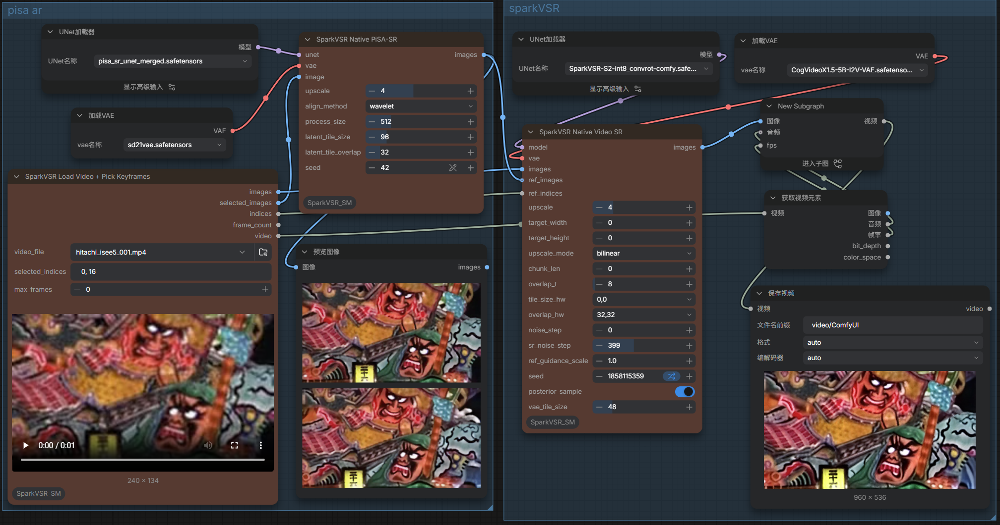

<div align="center">
  <p></p>
  <h1>SparkVSR: Interactive Video Super-Resolution via Sparse Keyframe Propagation</h1>
  <p>
    Jiongze Yu<sup>1</sup>, Xiangbo Gao<sup>1</sup>, Pooja Verlani<sup>2</sup>, Akshay Gadde<sup>2</sup>,
    Yilin Wang<sup>2</sup>, Balu Adsumilli<sup>2</sup>, Zhengzhong Tu<sup>†,1</sup>
  </p>
  <p>
    <sup>1</sup>Texas A&amp;M University &nbsp;&nbsp; <sup>2</sup>YouTube, Google
    <br>
    <sup>†</sup>Corresponding author
  </p>
  <p>
    <a href="https://sparkvsr.github.io/"></a>
    &nbsp;
    <a href="https://huggingface.co/JiongzeYu/SparkVSR"></a>
    &nbsp;
    <a href="https://arxiv.org/abs/2603.16864"></a>
  </p>
</div>

> 💡 **Your ⭐ star means a lot to us and helps support the continuous development of this project!**

# ComfyUI_SparkVSR_SM
-----
[SparkVSR](https://github.com/taco-group/SparkVSR): Interactive Video Super-Resolution via Sparse Keyframe Propagation

Update
-----
* 使用comfyUI的核心代码封装此方法,加快推理速度/ Use the core code of ComfyUI to encapsulate this method， speed up the inference speed  

1.Installation  
-----
  In the ./ComfyUI/custom_nodes directory, run the following:   
```
git clone https://github.com/smthemex/ComfyUI_SparkVSR_SM
```

2.checkpoints 
----
* 2.1 SparkVSR unet (comfy int8，bf16or gguf) [links](https://huggingface.co/smthem/SparkVSR-GGUF/tree/main)  
* 2.2 Cog vae [links](https://huggingface.co/JiongzeYu/SparkVSR/tree/main)  
* 2.3 if use pisa_sr need [stable-diffusion-2-1-base-vae](https://www.modelscope.cn/models/stabilityai/stable-diffusion-2-1-base) vae and [merger unet](https://huggingface.co/smthem/SparkVSR-GGUF/tree/main)

```
├── ComfyUI/models/
|     ├── diffusion_models/
|        ├──SparkVSR-S2-int8_convrot-comfy.safetensors # 5.5G or bf16
|     ├── vae/
|        ├──CogVideoX1.5-5B-I2V-VAE.safetensors #822M
##### optional pisa_sr ######
|     ├── diffusion_models/
|        ├──pisa_sr_unet_merged.safetensors # 1.5G
|     ├── vae/
|        ├──sd21vae.safetensors 
```

3.Example
----



4.Citation
----
```
@misc{yu2026sparkvsrinteractivevideosuperresolution,
      title={SparkVSR: Interactive Video Super-Resolution via Sparse Keyframe Propagation}, 
      author={Jiongze Yu and Xiangbo Gao and Pooja Verlani and Akshay Gadde and Yilin Wang and Balu Adsumilli and Zhengzhong Tu},
      year={2026},
      eprint={2603.16864},
      archivePrefix={arXiv},
      primaryClass={cs.CV},
      url={https://arxiv.org/abs/2603.16864}, 
}
```
